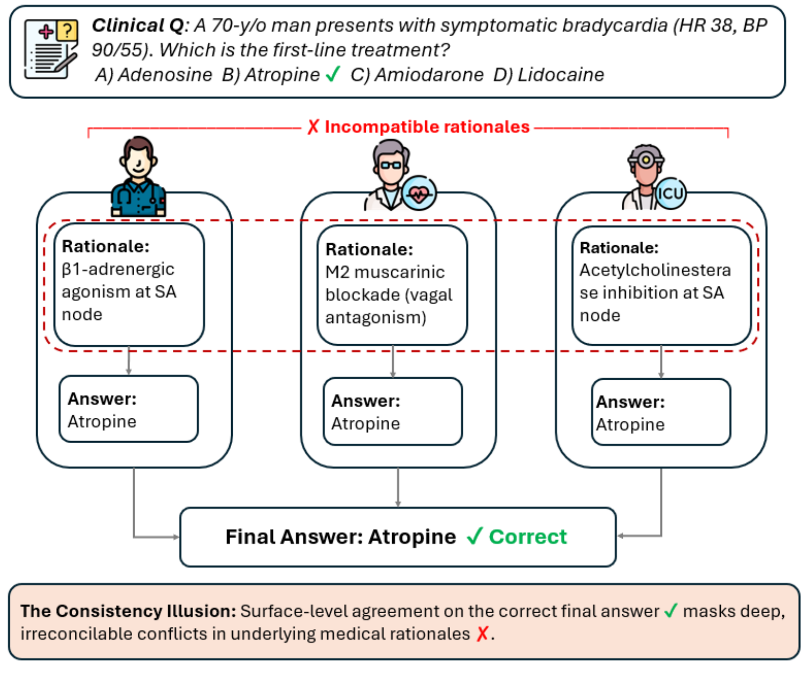
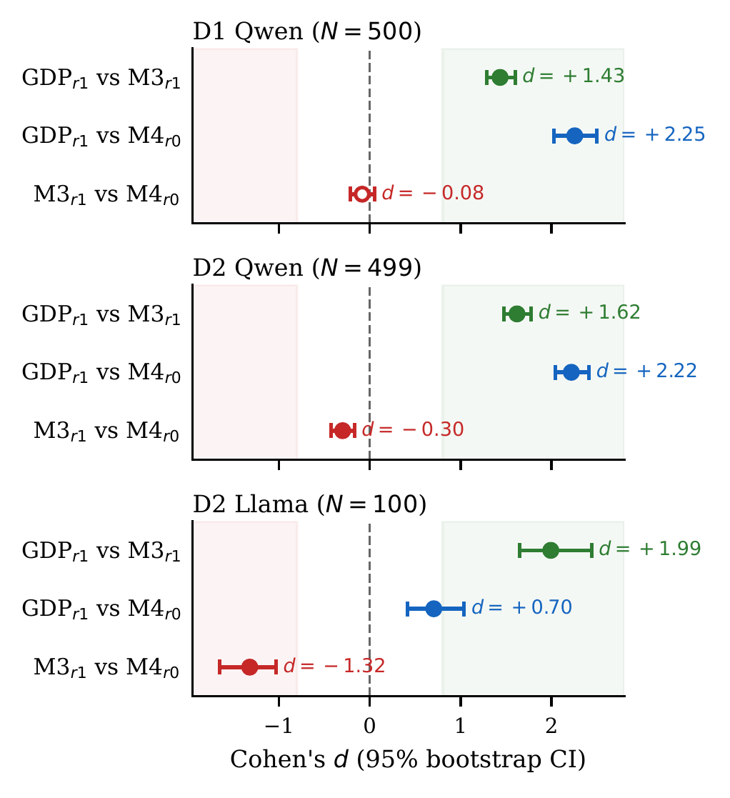

<div align="center">

# The Consistency Illusion: How Multi-Agent Debate Hides Reasoning Misalignment

**Xiaoyang Wang<sup>1</sup> &nbsp;·&nbsp; Christopher C. Yang<sup>1</sup>**

<sup>1</sup>Drexel University

[](https://2026.emnlp.org/) [](https://arxiv.org/abs/2606.08457) [](requirements.txt) [](LICENSE)

</div>

<p align="center">
  
</p>

**Figure 1** | Three agents agree on the clinically correct answer (atropine for symptomatic bradycardia), yet their rationales invoke three mutually exclusive pharmacological targets. Answer agreement does not tell you whether the reasoning agrees.

Multi-agent LLM systems for medical QA treat consensus as a reliability signal: if the agents agree, the answer is presumed trustworthy. We introduce **CARA** (Cross-Agent Reasoning Alignment), a family of automated metrics that measure whether agents who agree on an answer also agree on the reasoning. Applying CARA to a standard debate system, we find the **consistency illusion**: debate reduces visible contradictions between agents while the semantic similarity of their reasoning chains also drops. The **Grounded Debate Protocol (GDP)**, a prompt-level change, repairs this alignment without adding LLM calls.

This repository contains the CARA implementation, the GDP prompts, the per-question scores behind every number in the paper, and the scripts that recompute them. Reproducing the paper needs no GPU, no API key, and no package installation.

## Results

Three systems, each with three agents and majority voting, on MedQA-USMLE (D1, N = 500) and MedThink-Bench (D2, N = 499):

| ID | System | Rounds |
|---|---|---|
| M4 | Independent voting (no communication) | r0 |
| M3 | Symmetric debate of Du et al. (2024): an independent round, then one debate round | r0, r1 |
| M3-GDP | M3 with the Grounded Debate Protocol prompts | r0, r1 |

Effect sizes on CARA-HYB (Cohen's *d*; bold = 95% bootstrap CI excludes zero):

| Comparison | D1 MedQA · Qwen 2.5 72B | D2 MedThink · Qwen 2.5 72B | D2 MedThink · Llama 3.3 70B |
|---|:---:|:---:|:---:|
| Consistency illusion: debate (M3 r1) vs. independent voting (M4 r0) | −0.08 | **−0.30** | **−1.32** |
| GDP repair: GDP debate (M3-GDP r1) vs. standard debate (M3 r1) | **+1.43** | **+1.62** | **+1.99** |

<p align="center">
  
</p>

**Figure 2** | Cohen's *d* for three pairwise comparisons, one panel per dataset and backbone, with 95% bootstrap CIs (B = 10,000). Filled markers exclude zero; shading marks |*d*| > 0.8. GDP reaches a large effect in every condition; the consistency-illusion comparison (bottom row) is significantly negative on D2 with both backbones.

The illusion shows up as two measures that disagree. On D2 with Qwen 2.5 72B, debate cuts the contradiction rate by more than half, which looks like better alignment, while reasoning similarity falls; GDP debate raises similarity well above both:

| D2 MedThink · Qwen 2.5 72B | Contradiction rate (CR) | Reasoning similarity (CARA-SIM) |
|---|:---:|:---:|
| Independent round (M3 r0) | 0.14 | 0.80 |
| After standard debate (M3 r1) | 0.05 | 0.77 |
| After GDP debate (M3-GDP r1) | 0.13 | 0.91 |

Against the expert reasoning annotated in MedThink-Bench (CARA-GT), standard debate lowers expert coverage from 88.8% (independent voting) to 80.2%, and GDP debate recovers it to 85.6%.

## Reproduce the paper

The analysis scripts use only the Python standard library and read the released records in `data/`.

```bash
git clone https://github.com/wangxiaoyang0412/consistency-illusion.git
cd consistency-illusion
python code/analysis/table1_cell_means.py
```

Expected output:

```
Table 1: mean CARA-HYB / CARA-SIM / CR per cell (Qwen 2.5 72B)

                       D1 MedQA-USMLE                  D2 MedThink-Bench
System  Round              N     HYB     SIM      CR       N     HYB     SIM      CR
M3-GDP  r1 (debate)      498   0.952   0.912   0.098     497   0.952   0.914   0.127
M3-GDP  r0 (indep.)      497   0.912   0.835   0.117     473   0.912   0.836   0.137
M4      r0 (indep.)      500   0.895   0.801   0.108     470   0.895   0.801   0.161
M3      r0 (indep.)      498   0.895   0.801   0.104     471   0.896   0.801   0.144
M3      r1 (debate)      424   0.892   0.787   0.035     428   0.881   0.769   0.053
```

| Paper item | Command or released file | Notes |
|---|---|---|
| Table 1 (CARA-HYB / SIM / CR per cell) | `python code/analysis/table1_cell_means.py` | seconds |
| Figure 2, effect sizes and CIs; Appendix C (CARA-GT) | `python code/analysis/bootstrap_ci.py` | B = 10,000, seed 42; about 4 minutes; also writes `bootstrap_ci_report.md` |
| Cross-backbone table (Llama 3.3 70B) | `python code/analysis/table1_cell_means.py --llama` | Δ CARA-HYB rows; the *d* rows come from `bootstrap_ci.py` |
| Table 2 (failure-mode taxonomy) | `data/failure_modes/` | classified cases and taxonomy reports |
| §7 GPT-4o head-to-head (4.86 vs. 4.50) | `data/cara_llm/cara_llm_scores.jsonl` | pre-computed judge scores, no API key needed |
| Appendix D (accuracy, McNemar) | `data/accuracy/accuracy_report.md` | pre-computed report |
| Appendix E (parsing rate, segmentation stability) | `data/segmentation_sensitivity/` | `segsens_report.md` and per-strategy score files |
| Appendix G (label stripping: about 90% of the GDP gain survives) | `python code/analysis/compare_labelstripped.py` | writes `data/labelstripping/labelstripped_report.md` |
| Appendix G (generic-structure and anti-sycophancy arms) | `data/ablation_e1/` | `e1_ablation_report.md` and `cara_scores_e1.jsonl` |
| Appendix H (inter-annotator agreement, Spearman 0.93–0.99) | `data/annotation/` | three scored annotation sheets |
| Appendix L (answer-change decomposition) | `python code/analysis/flip_decomposition.py` | prints the 2×2 decomposition |

## Method in brief

**CARA** (`code/cara/`). For each question, the *agreement set* is the agents that voted for the majority answer; CARA is computed only when it has at least two agents. Each rationale is split into steps (`step_decomposer.py`). For every step pair across two agents, a DeBERTa-v3 NLI model flags contradictions (`nli_scorer.py`, threshold 0.7); non-contradictory pairs are scored by the cosine similarity of Stella embeddings (`embedding_scorer.py`). CARA-HYB matches each step to its best counterpart, symmetrizes over the two directions, averages over agent pairs, and rescales to [0, 1] (`cara_hyb.py`). The contradiction rate (CR) is the share of best-matched step pairs flagged as contradictions. `pipeline.py` (`run_cara_pipeline`) runs the full scoring on new traces, about 9,000 traces per hour on one RTX 4090.

**GDP** (`code/prompts/prompt_builder_gdp.py`). Each reasoning step becomes a **CLAIM** (one falsifiable clinical assertion) with a **GROUND** (the named fact, mechanism or guideline behind it). In the debate round, agents add a **STANCE** (agree, disagree or extend) toward specific claims of the other agents, and may switch answers only for a more compelling GROUND or a factual error in their own reasoning. Agent routing and the number of LLM calls are unchanged. The builders return chat messages for any chat-completion backend:

```python
import sys
sys.path.insert(0, "code/prompts")
from prompt_builder_gdp import build_gdp_round0_prompt, build_gdp_debate_prompt

# Round 0: each agent answers independently in CLAIM / GROUND format.
messages = build_gdp_round0_prompt(question_text)
# Round 1: each agent reads the others' round-0 answers and adds STANCE.
messages = build_gdp_debate_prompt(question_text, own_round0_response, other_agents_responses)
```

The standard debate prompts (M3) are in `code/prompts/prompt_builder_m3.py`.

## Data

`data/` holds per-question CARA, CARA-GT and GPT-4o judge scores keyed by question ID for every (system, round, dataset, backbone) cell, including label-stripped and segmentation variants, together with classified failure cases and the human-expert annotation sheets. The benchmarks are available from their original sources:
- **MedQA-USMLE**: [github.com/jind11/MedQA](https://github.com/jind11/MedQA) (Jin et al., 2021)
- **MedThink-Bench**: Zhou et al. (2025), *npj Digital Medicine*

## Repository layout

```
code/
  cara/          CARA-HYB / SIM / NLI scoring: step decomposition, NLI and embedding
                 scorers, pipeline, CARA-GT, label-stripping utilities
  analysis/      scripts that recompute the paper's tables, CIs and appendix analyses
  prompts/       M3 and GDP prompt builders; CARA-LLM judge invocation
data/
  cara_scores/               per-question CARA scores per (system, round, dataset, backbone)
  cara_gt/                   agent-to-expert alignment scores (D2)
  cara_llm/                  GPT-4o judge scores per agent pair
  accuracy/                  majority-vote accuracy and McNemar report
  ablation_e1/               generic-structure and anti-sycophancy control arms
  segmentation_sensitivity/  alternative step-segmentation runs
  flip_analysis/             per-question answer-change records
  failure_modes/             classified low-CARA cases and taxonomy reports
  annotation/                human-expert validation sheets and guidelines
assets/          figures used in this README
```

## Citation

```bibtex
@inproceedings{wang2026consistency,
  title     = {The Consistency Illusion: How Multi-Agent Debate Hides Reasoning Misalignment},
  author    = {Wang, Xiaoyang and Yang, Christopher C.},
  booktitle = {Proceedings of the 2026 Conference on Empirical Methods in Natural Language Processing (EMNLP)},
  year      = {2026},
  address   = {Budapest, Hungary},
  publisher = {Association for Computational Linguistics}
}
```

## License and acknowledgments

The code in this repository is released under the MIT License. This work was supported in part by the National Science Foundation under IIS-2235548 and by the Department of Defense under Grant DoD W91XWH-05-1-023.

Questions: xw388@drexel.edu, or open a GitHub issue.
